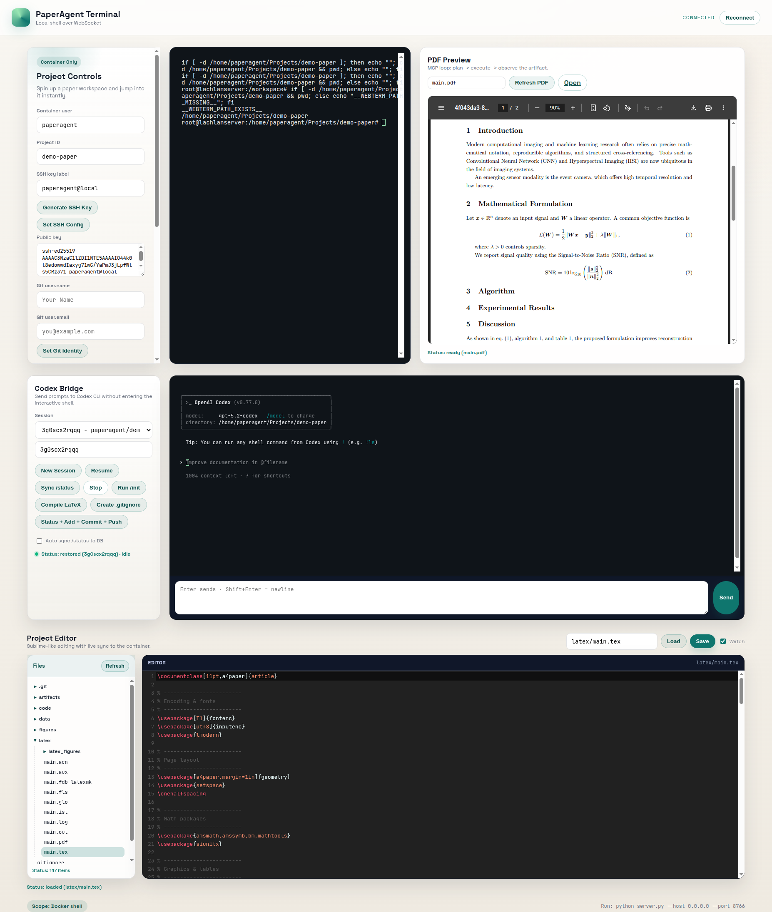

[English](README.md) | [繁體中文](README.zh-Hant.md) | 简体中文 | [日本語](README.ja.md) | [한국어](README.ko.md) | [Tiếng Việt](README.vi.md) | [العربية](README.ar.md) | [Français](README.fr.md) | [Español](README.es.md)

  

 

# PaperAgent

PaperAgent 是一个本地优先的论文写作工作台：在浏览器中编辑 LaTeX 与代码，后端执行 Python/R 并编译 LaTeX，在同一处预览 PDF 与编译日志。

## 愿景

PaperAgent 的愿景是让每个人从研究的琐事中解放，回到“只有想法”。
核心很简单：把思考留给人，把重复工作交给系统。
你专注于想法与叙事，PaperAgent 处理执行循环。

## 理念

- 本地优先、隐私优先：数据与执行默认留在你的机器。
- 想法优先流程：从概念到可执行论文的摩擦最小化。
- 小步可逆：每次变更清晰可回退。
- 工具应该减少工作：自动化是为了删除琐事，而不是增加。

## 逻辑（如何运作）

1) 聊天 → 编辑：描述改动，PaperAgent 修改正确文件。
2) 执行 → 编译：跑 Python/R、编译 LaTeX、生成图表。
3) 预览 → 迭代：查看 PDF 与日志，快速修正再继续。

## 你会得到

- 连接 Docker 沙盒的 Web 终端
- LaTeX 项目骨架与一键编译
- 用 Python/R 生成图表与实验
- PDF 预览与编译日志
- 简洁的 PWA 界面

## 项目状态

- PWA 工作台：Web 终端、PDF 预览、编辑器。
- 项目控制：创建工作区、初始化 LaTeX、编译、Git/SSH 辅助。
- Codex Bridge：会话恢复、DB 历史列表、/status 同步开关。
- 文件树 + CodeMirror 编辑器（保存/监听）。
- Docker 后端执行（可选），含 LaTeX/Python/R 工具链。

## 演示

## 主项目

- https://github.com/lachlanchen/the-art-of-lazying

## 生态链接

- https://lazying.art 🎨 
- https://onlyideas.art 💡 
- https://chat.lazying.art 🧠
- https://paper.lazying.art 📄
- https://coin.lazying.art 🪙
- https://earn.lazying.art 💸
- https://learn.lazying.art 📚
- https://robot.lazying.art 🤖
- https://glass.lazying.art 👓
- https://ideas.onlyideas.art 🧪

### 捐赠

<!-- support:start -->

<!-- support:end -->

你的支持将用于研发与运维，帮助我持续公开更多项目与改进。
